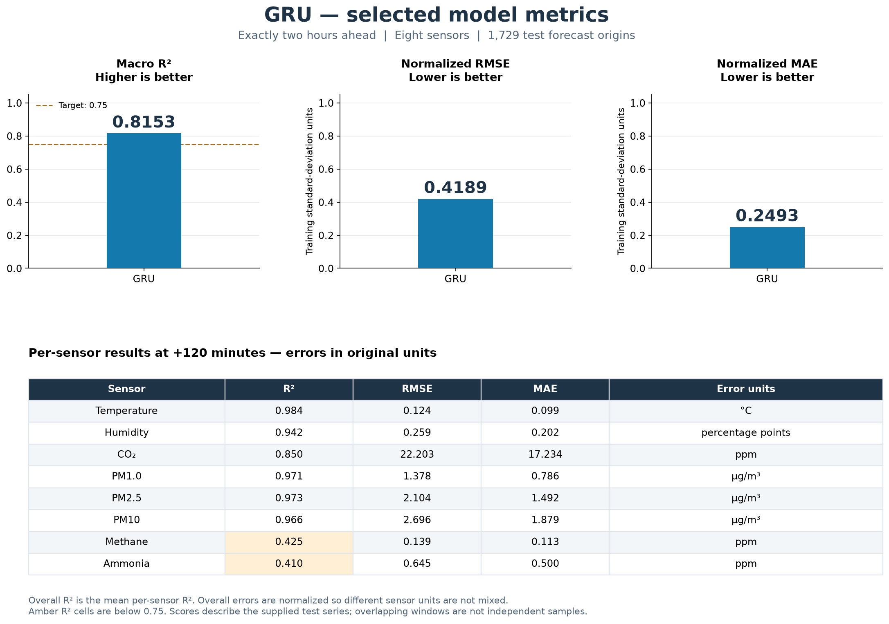
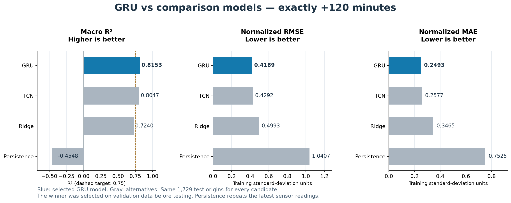

# GRU microclimate model — client guide

## What the model does

The selected GRU uses the latest **120 consecutive one-minute readings** to
predict all eight sensor readings for **each of the next 120 minutes**. Its output
contains 120 UTC timestamps and eight sensor columns. The last row is exactly
two hours after the latest input. No training is needed to use the exported model.

The client delivery has only nine files: the Joblib model, `predict.py`,
`requirements.txt`, this guide, one example input, its expected prediction,
`metrics_summary.csv`, and two graphs. The local `.venv` is deliberately excluded
from the delivery ZIP and is not required to be copied to another machine.

## 1. Selected model metrics



At exactly +120 minutes, GRU has **macro R² = 0.8153**, **normalized RMSE = 0.4189**,
and **normalized MAE = 0.2493** on the evaluation series. Higher R² is better;
lower RMSE/MAE is better. The top error scores use training-standard-deviation
units so °C, ppm and µg/m³ are not mixed. Macro R² is the unweighted mean of the
eight per-sensor R² scores; it is not a guarantee for every sensor.

The graph's lower table gives each sensor's R², RMSE and MAE in original units.
Six sensors exceed R² > 0.75; methane and ammonia remain below that target.
Humidity errors are percentage points. `metrics_summary.csv` contains 72 rows:
all four candidates, overall and per-sensor results, and both all-horizon and
exactly-two-hour summaries. Raw overall MAE/RMSE are blank because different
physical units cannot be meaningfully pooled.

## 2. Comparison with alternatives



Blue is the selected GRU; gray bars are the comparison candidates. GRU has the
highest macro R² and lowest normalized errors in this two-hour comparison. TCN
is close; Ridge and persistence perform less well. Persistence simply repeats
the latest reading throughout the forecast. All models use the same 1,729 test
origins. GRU was selected using validation results before the test comparison.

These metrics describe the project's evaluation dataset, not independent field
validation or reference-instrument calibration. Forecast windows overlap and are
not independent samples. Existing source provenance remains with the originating
project. Validate performance on fresh client measurements before relying on it
under different poultry-house conditions.

## 3. Run locally

From the client folder, activate your existing environment. **Do not recreate or
delete an environment you are already testing with.** On Linux/macOS:

```bash
source .venv/bin/activate
```

On Linux, use **`.venv/bin/activate`**; the `Scripts` directory is Windows-only.
On Windows, use `.venv\Scripts\activate`. For a new machine only, first create
an environment with `python -m venv .venv`, then activate it.

For CPU inference, only the small common requirements are needed. The CPU path
evaluates the saved GRU weights using NumPy; PyTorch is optional:

```bash
python -m pip install -r requirements.txt
python predict.py --input example_input.csv --output prediction.csv --device cpu
```

If CUDA-enabled PyTorch is already installed, keep it and use:

```bash
python -m pip install -r requirements.txt
python predict.py --input example_input.csv --output prediction.csv --device cuda
```

For installing a GPU build, use the [official PyTorch installation selector](https://pytorch.org/get-started/locally/).
`--device auto` chooses CUDA if available, otherwise CPU. CPU is sufficient for
inference. The original export was verified with Python 3.12 / PyTorch 2.7.1;
GPU inference requires a compatible newer wheel for Python 3.14. See the
[official compatibility matrix](https://github.com/pytorch/pytorch/blob/main/RELEASE.md).
Newer runtimes may produce small floating-point differences. Confirm behavior
with the supplied input and expected output rather than expecting byte-identical CSVs.
The NumPy CPU path was checked against the supplied expected output: the largest
difference was 0.000161 ppm for CO₂ (less than 0.000005 training standard deviations
across all sensors). It also rejects malformed input and missing minute intervals.

## 4. Input format and output

The CSV must contain exactly 120 rows, ascending timestamps, one row per UTC
minute, no duplicate/missing minutes, and no missing or nonfinite values.
Use the exact header and units from `example_input.csv`:

```text
Timestamp (UTC),Temp (°C),Humidity (%),CO2 (ppm),PM1.0 (µg/m³),PM2.5 (µg/m³),PM10 (µg/m³),Methane (ppm),Ammonia (ppm)
```

Humidity is 0–100%, gases are ppm, particulate values are µg/m³, and temperature
is °C. Concentrations must be nonnegative and PM1 ≤ PM2.5 ≤ PM10. Timestamps must
be aligned to minute boundaries. The loader rejects gaps instead of filling
them. Use raw sensor values: saved normalization and time features are applied
automatically. Output values return to the original units with common physical
bounds applied. Predictions are point estimates, not uncertainty intervals.

The example uses input from November 4, 2026 12:34–14:33 UTC and predicts
14:34–16:33 UTC. The last row is the exactly-two-hour forecast. These dates
belong to the dataset; live inputs produce timestamps relative to their own origin.
Compare your output with `example_predictions.csv` to check integration.

## 5. Use from Python

```python
import pandas as pd
from predict import load_forecaster, forecast_next_120_minutes

model = load_forecaster(device="cpu")  # or "cuda" / "auto"
recent = pd.read_csv("example_input.csv", index_col=0)
recent.index = pd.to_datetime(recent.index, utc=True)
forecast = forecast_next_120_minutes(recent, model)

print(forecast.iloc[[0, 29, 59, 89, 119]])
forecast.to_csv("prediction.csv", index_label="Timestamp (UTC)")
```

Only the most recent input readings and the trusted supplied model are needed.
Actual future readings are not inputs. Keep column order, units and sampling
interval unchanged when connecting the client application.

## Model and verification record

The model has two 64-unit GRU layers, 0.1 dropout and a 128-unit forecast head
(171,712 parameters). It predicts all horizons directly as changes from the
latest values. The completed training records contain 60 GRU epochs and 60 TCN
epochs. The saved export passed 27 verification checks. The corrected notebook
checks identical weights and matching inference batch sizes separately from
small batch-size numerical differences. No retraining was performed when these
graphs and this delivery were updated.
